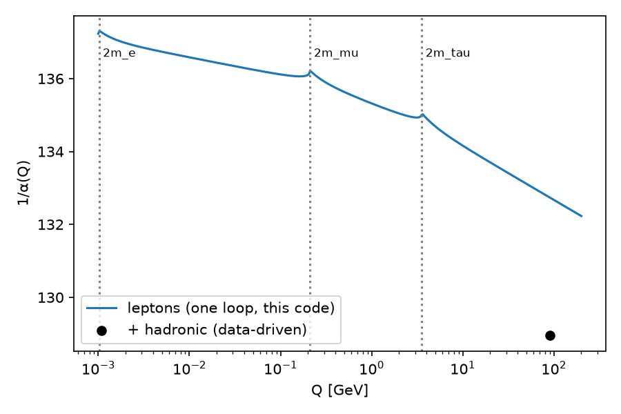
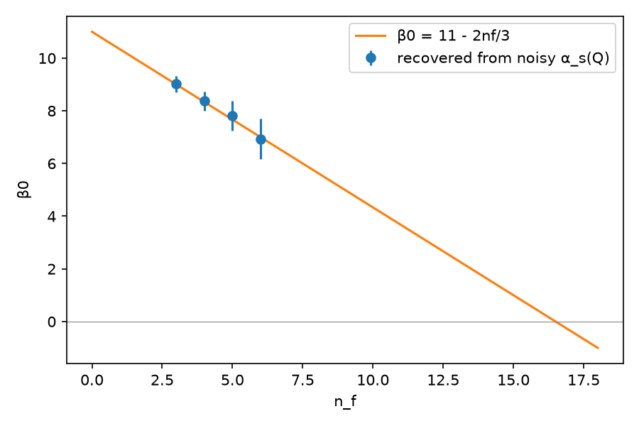

# qft-renorm-ai

[](https://github.com/gopalsharma1615-ai/qft-renorm-ai/actions/workflows/ci.yml)
 

**One-loop QED renormalization, done by code, and two experiments on where AI actually helps physics research.**

My M.Sc. project (NIT Calicut) was *Renormalization of Quantum Field Theory*: Feynman rules for QED, the
tree-level S-matrix for pair production, Compton, Møller and Bhabha scattering, the Ward–Takahashi identity,
dimensional regularization in n = 4 − ε, and the one-loop counterterms. This repository turns that work into
verified code, then asks two research questions:

- **A.** Can a machine recover the *β-function* (the core output of renormalization) from running-coupling data,
  and what does it take?
- **B.** Does giving an LLM a computer-algebra system make it a reliable loop-calculation assistant?

## What the code derives (thesis chapter → module)

| thesis chapter | `qftlab` | derived and asserted in tests |
|---|---|---|
| Feynman diagrams, QED | `dirac.py` | Clifford algebra; n-dim identities γ^μγ_μ = n, γ^μa̸γ_μ = (2−n)a̸, γ^μa̸b̸γ_μ = 4a·b − (4−n)a̸b̸, γ^μa̸b̸c̸γ_μ = −2c̸b̸a̸ + (4−n)a̸b̸c̸ (checked against explicit matrices) |
| Scattering matrix | `tree.py` | spin-averaged \|M\|² from explicit traces for **e⁺e⁻→μ⁺μ⁻** (massive), **Møller**, **Bhabha**, **Compton** = closed forms; lab-frame Compton = **Klein–Nishina**; Thomson limit 8πα²/3m² |
| Regularization | `loops.py` | master integrals in n = 4 − ε; Γ(ε/2) = 2/ε − γ_E + … |
| Calculations in QED | `loops.py` | vacuum polarization: dim-reg makes (2/n − 1)I₂ + ΔI₀ ≡ 0, so **Π^{μν} ∝ (q²g − qq) emerges** (gauge invariance), Π_pole = −(α/3π)(2/ε); self-energy Σ_pole = (α/4π)(2/ε)(−p̸ + 4m); vertex Λ_pole = (α/4π)(2/ε)γ^μ |
| Ward–Takahashi identity | `loops.py` | **δZ₁ = δZ₂ = −(α/4π)(2/ε)** |
| Renormalization | `loops.py`, `running.py` | δZ₃ = −(α/3π)(2/ε), δm = (3α/4π)(2/ε)m, **β(e) = e³/12π²**, β(α) = 2α²/3π; finite running α(q²) with lepton masses |

Nothing is typed in from a textbook. The code derives each result from the Feynman rules and the n-dimensional
identities, and `pytest` (20 tests) checks it against the known answer.

## Experiment A: from running-coupling data back to the β-function

Method: the RG equation dα/dL = β(α) (L = ln μ²) is written in weak form so that noisy data is never
differentiated:

  1/α(L) − 1/α(L₀) = Σ_k c_k ∫ α^k dL

The integrals come from the data, and sparse regression (STLSQ, as in SINDy) picks the terms. Results are in
[`results/exp_a.json`](results/exp_a.json), reproduced by `python experiments/exp_a_running.py --plots results/`.

**A1. QED: what one-loop leptons can and cannot explain.** From α(0)⁻¹ = 137.036:

| | Δα(M_Z²) | 1/α(M_Z) |
|---|---|---|
| e / μ / τ loops (this code) | 0.01744 / 0.00918 / 0.00481 | |
| all leptons, one loop | **0.03142** | **132.73** |
| + data-driven hadronic Δα⁽⁵⁾_had ≈ 0.0276 | 0.0590 | **128.95** |

Perturbative leptons account for only about half (53%) of the running to M_Z. The rest is hadronic, and it cannot be computed
perturbatively at low q², which is why it comes from e⁺e⁻ → hadrons data. With it, the code lands on the
standard on-shell value.



**A2. QCD: recovering β₀ and β₁ from noisy α_s(Q).** The data are simulated: 40 log-spaced points from 2 to
2,000 GeV generated with two-loop running from α_s(M_Z) = 0.1180, plus 0.5–2% Gaussian noise, with 50 noise
seeds per setting. The table uses 0.5% noise.

| n_f | β₀ true | β₀ recovered | β₁ true | β₁, free 3-term library | β₁, physics-informed 2-term library |
|---|---|---|---|---|---|
| 3 | 9.00 | 9.02 ± 0.31 | 64.0 | 60.5 ± 43.0 | **64.9 ± 5.3** |
| 4 | 8.33 | 8.37 ± 0.36 | 51.3 | 45.0 ± 55.8 | **51.2 ± 5.8** |
| 5 | 7.67 | 7.81 ± 0.57 | 38.7 | 17.4 ± 94.7 | **36.1 ± 9.1** |
| 6 | 7.00 | 6.94 ± 0.76 | 26.0 | 39.5 ± 133.9 | **24.6 ± 12.1** |

Fitting the recovered β₀ across n_f gives **β₀ = 11.10 − 0.680·n_f** (theory: 11 − 0.667·n_f), so
**asymptotic freedom is lost at n_f ≈ 16.3** (theory: 16.5). At 2% noise this degrades to 15.4.



**What this shows:**
- The one-loop structure (1/α linear in ln Q²) is robustly identifiable from percent-level data.
- The two-loop coefficient is not identifiable with a generic library. Over this range α and α² are nearly
  collinear, and the spurious α² term is rejected in only 20–28% of trials.
- Constraining the library to the form perturbation theory predicts recovers β₁ to about 10%.

The lesson for AI in physics: **discovery from data needs the right inductive bias**, and here theory supplies
it.

**A3. The running counts the leptons.** Fitting d(1/α)/d ln q² = −N/(3π) between thresholds recovers
N = **1.04** (2–60 MeV), **2.06** (0.5–1.5 GeV) and **3.04** (10–90 GeV).

## Experiment B: LLM vs LLM + CAS on loop calculations

Twenty-four tasks drawn from the thesis chapters cover traces, n-dim contractions, ε-expansions, master-integral
poles, cross sections, the self-energy, δZ₁, δZ₂, δZ₃, δm and the β-function. Each has a SymPy-checkable answer,
and a test cross-checks the answer key against what `qftlab` derives.

The same model and prompt run in two conditions:
- **alone:** the model answers directly.
- **tools:** the model calls `qftlab` through function calling (`gamma_trace`, `sandwich`, `master_integral`,
  `series_eps`, `simplify`, `qed_counterterms`).

Grading is symbolic equivalence of the model's `FINAL:` line. There is no LLM judge.

```bash
export OPENAI_API_KEY=...     # or LLM_BASE_URL + LLM_MODEL for a local vLLM/Ollama model
python experiments/exp_b_llm_tools.py --model gpt-4o-mini --out results/exp_b_gpt-4o-mini.json
```

> **Status:** the harness, tasks and grading are complete and tested. The paid comparison has not been run yet,
> and its results will be added here with the model names and dates. TODO.

The same tools are served over **MCP**, so any MCP client (Claude Desktop, Claude Code, IDEs) can use them:

```bash
pip install "qft-renorm-ai[agent] @ git+https://github.com/gopalsharma1615-ai/qft-renorm-ai"
claude mcp add qft-tools -- qft-tools-mcp
```

Expressions that come from a model are parsed through a strict whitelist of characters and names, so model
output never reaches `eval` unchecked.

## Conventions

The metric is (+,−,−,−) and the Dirac representation is used. Dimensional regularization uses
**n = 4 − ε** (so poles appear as 2/ε), with the coupling rescaled as e → eμ^{ε/2}, Feynman gauge and minimal
subtraction. Texts that use d = 4 − 2ε have ε_theirs = ε/2, so their 1/ε_theirs is the 2/ε here.

## Development

```bash
python -m venv .venv && . .venv/bin/activate && pip install -e ".[plots,agent,dev]"
pytest -q && ruff check .
```

MIT licence. Built by [Gopal Sharma](https://github.com/gopalsharma1615-ai), M.Sc. Physics (NIT Calicut),
CSIR-UGC NET AIR 81.
